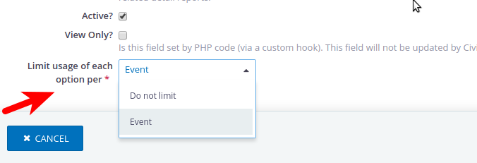

# CiviCRM Inventory Field



Allows defining a custom 'select' field so that usage of select options is limited to once-per-event.

The extension is licensed under [GPL-3.0](LICENSE.txt).

## Usage
When editing or creating a custom field which is a) of type "Drop-down (select)" and b) in a Custom Field Group that applies to Participants, set the "Limit usage of each option per" field to "Event".

You may then optionally set the "Limit usage count" setting to any positive integer (default is 1), to limit the usages per event to that amount.

For fields so configured, this extension will prevent more than one participant per event from selecing any given value in the select options, in on-line registration forms. Once an option has been used by a participant at an event, it will be labeled "Unavailable" and disabled in on-line registration forms for that event.

Note: This setting has no effect on back-office paticipant management forms; therefore, when editing or creating participants through CiviCRM's back-office features, it is still possible to assign the same option to multiple participants.

## Requirements

* PHP v7.0+
* CiviCRM >= 5.0

## Installation (Web UI)

This extension has not yet been published for installation via the web UI.

## Installation (CLI, Zip)

Sysadmins and developers may download the `.zip` file for this extension and
install it with the command-line tool [cv](https://github.com/civicrm/cv).

```bash
cd <extension-dir>
cv dl com.joineryhq.inventoryfield@https://github.com/JoineryHQ/com.joineryhq.inventoryfield/archive/master.zip
```

## Installation (CLI, Git)

Sysadmins and developers may clone the [Git](https://en.wikipedia.org/wiki/Git) repo for this extension and
install it with the command-line tool [cv](https://github.com/civicrm/cv).

```bash
git clone https://github.com/JoineryHQ/com.joineryhq.inventoryfield.git
cv en inventoryfield
```

## Support

Support for this package is handled under Joinery's ["As-Is Support" policy](https://joineryhq.com/software-support-levels#as-is-support).

Public issue queue for this package: https://github.com/JoineryHQ/com.joineryhq.inventoryfield/issues
